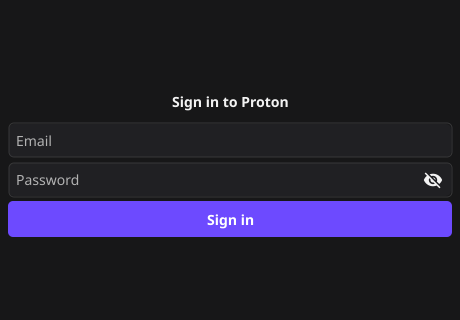
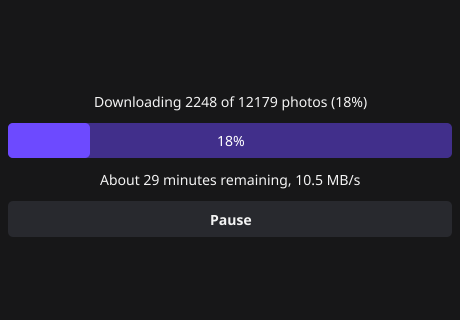

# Photos Export for Proton Drive

Simple open source tool to download all your photos from Proton Drive to a local folder.

This is not an official Proton product, and is not affiliated with Proton.

  
  

As of writing, the only official way to download all your photos from Proton Drive is to manually select them in the web interface and download them. This doesn't work well when you have a lot of photos, so I wrote this tool to automate the process.

## Features

- Already downloaded files are skipped if you stop the app and restart it later, as long as you save to the same folder. The folder is remembered between launches.
- Supports TOTP Two Factor Authentication (2FA).

## Install

Downloads are on the [releases page](https://github.com/tom-barone/proton-drive-photos-export/releases).

The macOS / Windows binaries aren't signed, so you may need to bypass some security settings to run them.

## Privacy

You are authenticated with Proton via the official [Proton API](https://github.com/ProtonMail/go-proton-api), and photos are downloaded straight from Proton's servers. The app makes no other network connections.

## AI Disclaimer

I used Fable 5 to help write this. Do with that information what you will.
